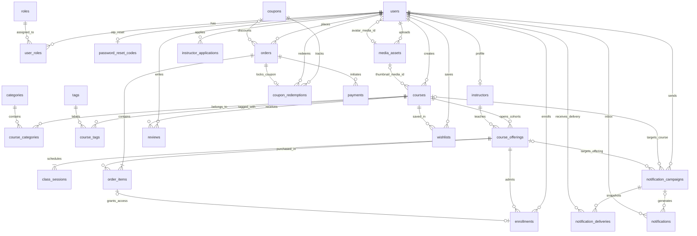

# 🎓 EduShop — Nền tảng Thương mại Khóa học & Quản lý Lớp học Trực tuyến (Full-Stack EdTech Marketplace)

**EduShop** là hệ thống thương mại điện tử giáo dục và quản lý lớp học trực tuyến theo đợt khai giảng (**Live Cohort Classroom Marketplace**), được xây dựng theo kiến trúc **Full-Stack** gồm **Spring Boot 4.1.2 (Java 21)**, **React 19.3 (Vite 8.3 + Tailwind CSS 4.3)** và **MySQL 8.0 (Flyway Migrations V1–V12)**.

Khác với mô hình bán khóa học quay sẵn đơn thuần, **EduShop** giải quyết trọn vẹn bài toán vận hành lớp học trực tuyến thực tế:
- Quản lý vòng đời **Khóa học (`Course`)** kèm cơ chế **Thùng rác (`Soft Delete / Restore / Permanent Purge`)**.
- Mở bán nhiều **Lớp học theo đợt khai giảng (`Course Offering`)** có giới hạn sĩ số (`capacity`), hạn đăng ký và giảng viên phụ trách.
- Xây dựng **Lịch học trực quan (`ScheduleBuilder`)** và quản lý chi tiết từng **Buổi học (`Class Session`)** kèm thông tin phòng học **Google Meet / Zoom** được bảo vệ quyền truy cập.
- Cơ chế **Đặt đơn giữ chỗ 15 phút (`Seat Reservation`)** sử dụng khóa bi quan (`SELECT ... FOR UPDATE`) chống bán vượt sĩ số.
- Hệ thống **Mã giảm giá (`Coupon`)** đa điều kiện với vòng đời giữ mã nguyên tử (`RESERVED` → `CONSUMED` / `RELEASED`).
- Tích hợp thanh toán trực tuyến **ZaloPay Sandbox v2**, **MoMo v2 (IPN Webhook)**, **DEV_SIMULATOR** và công cụ **Đối soát giao dịch (`Reconciliation`)**.
- Hỗ trợ học viên vào **Phòng học trực tuyến (`Classroom`)**, tải lịch học chuẩn **iCalendar (`.ics`)** cho Google Calendar / Outlook, đánh giá khóa học xác thực và nhận thông báo chiến dịch.

> 📄 **Tài liệu Báo cáo Kỹ thuật đầy đủ (Word `.docx`):** Xem file [`BAO_CAO_DU_AN_EDUSHOP.docx`](./BAO_CAO_DU_AN_EDUSHOP.docx) đặt ngay tại thư mục gốc dự án (bao gồm Sơ đồ ERD chuẩn StarUML 25 bảng độ phân giải cao, Sơ đồ Kiến trúc, Sơ đồ Vòng đời UML State Machine, Ma trận Phân quyền và Đặc tả CRUD chi tiết).

---

## 📑 Mục lục

1. [Tổ hợp Công nghệ Sử dụng (Tech Stack)](#1-tổ-hợp-công-nghệ-sử-dụng-tech-stack)
2. [Cấu trúc Thư mục Dự án](#2-cấu-trúc-thư-mục-dự-án)
3. [Những Tính năng & Nghiệp vụ Cốt lõi đã Hoàn thiện](#3-những-tính-năng--nghiệp-vụ-cốt-lõi-đã-hoàn-thiện)
4. [Thiết kế Cơ sở dữ liệu & Sơ đồ ERD (25 Bảng, Flyway V1–V12)](#4-thiết-kế-cơ-sở-dữ-liệu--sơ-đồ-erd-25-bảng-flyway-v1v12)
5. [Cơ chế Bảo mật & Ma trận Phân quyền (RBAC & Ownership)](#5-cơ-chế-bảo-mật--ma-trận-phân-quyền-rbac--ownership)
6. [Đặc tả Đầy đủ Nghiệp vụ CRUD theo Phân hệ](#6-đặc-tả-đầy-đủ-nghiệp-vụ-crud-theo-phân-hệ)
7. [Danh mục REST API Endpoints (25 Controllers)](#7-danh-mục-rest-api-endpoints-25-controllers)
8. [Hướng dẫn Cài đặt & Chạy Dự án](#8-hướng-dẫn-cài-đặt--chạy-dự-án)
9. [Bộ Dữ liệu Mẫu 30 Khóa học (`seed-demo30.sql`)](#9-bộ-dữ-liệu-mẫu-30-khóa-học-seed-demo30sql)
10. [Hướng dẫn Thanh toán ZaloPay Sandbox & MoMo Sandbox](#10-hướng-dẫn-thanh-toán-zalopay-sandbox--momo-sandbox)
11. [Kiểm thử Tự động (Backend & Frontend Tests)](#11-kiểm-thử-tự-động-backend--frontend-tests)

---

## 1. Tổ hợp Công nghệ Sử dụng (Tech Stack)

| Tầng / Thành phần | Công nghệ & Phiên bản | Vai trò trong dự án EduShop |
| :--- | :--- | :--- |
| **Backend Core** | **Java 21 LTS** + **Spring Boot 4.1.2** | Xây dựng RESTful API (`/api/v1/**`), sử dụng Java Records cho DTO bất biến, quản lý qua Maven Wrapper (`mvnw`). |
| **Bảo mật & Xác thực** | **Spring Security 6** + **OAuth2 Resource Server (JWT)** | Xác thực Stateless JWT ký bằng `HMAC-SHA256`, mã hóa mật khẩu & OTP bằng `BCryptPasswordEncoder`, giới hạn tần suất qua `AuthRateLimitFilter`. |
| **Truy cập Dữ liệu** | **Spring Data JPA (Hibernate)** + **JdbcTemplate** | Kết hợp ORM cho mô hình miền và SQL thuần tối ưu cho báo cáo, thống kê, khóa dòng `SELECT ... FOR UPDATE`. |
| **Cơ sở dữ liệu & Migration** | **MySQL 8.0 (InnoDB, utf8mb4)** + **Flyway (V1–V12)** | Quản lý 25 bảng chuẩn 3NF, tự động nâng cấp schema qua 12 phiên bản migration, sử dụng `GENERATED STORED COLUMN` và `CHECK` constraints. |
| **Cổng Thanh toán** | **ZaloPay Sandbox v2** + **MoMo v2** + **DEV_SIMULATOR** | Tạo giao dịch thanh toán QR/Thẻ ATM nội địa, xác thực chữ ký `HMAC-SHA256`, xử lý IPN Webhook và đối soát giao dịch (`Reconciliation`). |
| **Email & Lưu trữ Media** | **Spring Boot Mail (SMTP)** + **UUID Local Media** | Gửi mã OTP 6 chữ số khôi phục mật khẩu; kiểm tra chữ ký nhị phân (`Magic Bytes`) của tệp ảnh tải lên (`PNG`, `JPEG`, `WEBP`, `GIF`). |
| **Tài liệu hóa API** | **SpringDoc OpenAPI 3.1.1 (Swagger UI)** | Giao diện tài liệu và thử nghiệm API trực quan tại `http://localhost:8080/swagger-ui/index.html`. |
| **Frontend SPA** | **React 19.3.1** + **Vite 8.3.5** + **React Router 7.18.5** | Ứng dụng Single Page Application chia 5 phân khu (`public`, `auth`, `buyer`, `instructor`, `admin`). |
| **Giao diện & Tiện ích** | **Tailwind CSS 4.3.3** + **Lucide React 1.64** + **iCalendar (`.ics`)** | Hỗ trợ giao diện Sáng/Tối (`ThemeContext`), bảng dữ liệu (`DataTable`), xếp lịch (`ScheduleBuilder`), tự lưu nháp (`localStorage`) và xuất lịch `.ics`. |
| **Kiểm thử** | **JUnit 5 + Spring MockMvc** + **Node Test Runner** | 12 bộ kiểm thử tích hợp Backend trên DB độc lập (`edushop_test`) và kiểm thử đơn vị Frontend (`npm test`). |

---

## 2. Cấu trúc Thư mục Dự án

```text
edushop/
├── backend/                                  # Spring Boot 4.1.2 (Java 21) REST API
│   ├── src/main/java/com/edushop/
│   │   ├── config/                           # Cấu hình Security, CORS, OpenAPI, Clock, ProductionGuard
│   │   ├── controller/                       # 25 REST Controllers (/api/v1/**)
│   │   ├── dto/                              # Java Records cho Request/Response payloads
│   │   ├── entity/                           # Các thực thể JPA (Course, CourseOffering, ClassSession...)
│   │   ├── exception/                        # ApiExceptionHandler chuẩn hóa lỗi RFC 7807 ProblemDetail
│   │   ├── repository/                       # Spring Data JPA Repositories (kèm Pessimistic Locking)
│   │   ├── security/                         # JwtTokenService, AuthRateLimitFilter, SecurityConfiguration
│   │   └── service/                          # Tầng xử lý nghiệp vụ & Transaction Management
│   ├── src/main/resources/
│   │   └── db/migration/                     # 12 tệp Flyway SQL Migrations (V1__ đến V12__)
│   └── src/test/java/com/edushop/            # 12 bộ Integration & Security Test Suites
├── frontend/                                 # React 19 + Vite 8 + Tailwind CSS 4 SPA
│   ├── public/images/                        # Ảnh bìa khóa học mẫu & tài nguyên giao diện
│   └── src/
│       ├── api/client.js                     # HTTP Client đính kèm Bearer JWT & bản địa hóa thông báo lỗi
│       ├── components/                       # UI Components (Modal, DataTable, ScheduleBuilder, ImagePicker...)
│       ├── contexts/                         # AuthContext, CartContext, WishlistContext, ThemeContext
│       ├── hooks/useApi.js                   # Custom Hook tải dữ liệu và reload tự động
│       ├── layouts/                          # PublicLayout, BuyerLayout, InstructorLayout, AdminLayout
│       ├── pages/
│       │   ├── public/                       # Home, Catalog, CourseDetail, InstructorContact, Forbidden, NotFound
│       │   ├── auth/                         # Login, Register, ForgotPassword, Account
│       │   ├── buyer/                        # BuyerHome, ShoppingHub, Cart, Checkout, Orders, OrderDetail, Classroom, Reviews, Wishlist
│       │   ├── instructor/                   # InstructorHome, InstructorCourses, InstructorOfferings, InstructorSessions, Enrollments, InstructorProfile
│       │   └── admin/                        # AdminDashboard, Users, InstructorManagement, InstructorApplications, Categories, Tags, Courses, Offerings, Sessions, CouponManagement, Orders, Payments, Reconciliation, Enrollments, Reviews
│       └── utils/                            # Định dạng tiền tệ/ngày tháng, xuất lịch .ics (calendar.js), kiểm thử
└── README.md                                 # Tài liệu hướng dẫn toàn diện dự án
```

---

## 3. Những Tính năng & Nghiệp vụ Cốt lõi đã Hoàn thiện

1. **Xác thực JWT Stateless & Đặt lại mật khẩu qua OTP Email:**
   - Đăng ký, đăng nhập nhận Bearer Token (`HMAC-SHA256`).
   - Quên mật khẩu gửi mã OTP 6 chữ số có băm `BCrypt`, giới hạn thời gian chờ gửi lại (`next_send_at`) và số lần nhập sai (`attempts`).
2. **Bảo vệ chống Vét cạn (Sliding-Window Rate Limiter):**
   - Giới hạn theo địa chỉ kết nối thực trong cửa sổ 60 giây: Đăng nhập (`20 lần`), Đăng ký (`10 lần`), Yêu cầu mã OTP (`5 lần`), Đặt lại mật khẩu (`10 lần`). Trả về `HTTP 429 Too Many Requests` kèm header `Retry-After`.
3. **Quản lý Vòng đời Khóa học & Thùng rác (`Course Lifecycle & Trash`):**
   - Hỗ trợ đầy đủ: Tạo nháp (`DRAFT`) → Xuất bản (`PUBLISHED`) → Lưu trữ (`ARCHIVED`) → Đưa vào Thùng rác (`deleted_at != NULL`) → Khôi phục về bản nháp (`Restore`) hoặc Xóa vĩnh viễn (`Permanent Purge` khi chưa có lịch sử giao dịch).
4. **Quản lý Lớp mở bán (`Course Offerings`) & Bảo vệ Dữ liệu Nhập:**
   - Tạo lớp theo đợt khai giảng với mã lớp tự động, sĩ số, học phí VND, hạn đăng ký.
   - **Chống mất dữ liệu khi thêm lớp:** Cửa sổ `Modal` khóa đóng nhầm khi bấm ra ngoài vùng nền mờ (`dismissible = false`) và **tự động lưu nháp tức thời (`localStorage`)** cho mọi trường thông tin cùng danh sách buổi học đang xếp dở.
   - **Kiểm soát chặt trạng thái lớp:** Lớp `Đã hủy (CANCELLED)` hoặc `Đã hoàn thành (COMPLETED)` tự động ẩn toàn bộ các nút chỉnh sửa/hủy để tránh thao tác sai; nút `Hoàn thành` chỉ hiển thị khi lớp đã qua ngày kết thúc.
5. **Xếp lịch học tự động (`ScheduleBuilder`) & Quản lý Phòng học trực tuyến:**
   - Chọn các thứ trong tuần và khung giờ để sinh tự động toàn bộ buổi học từ ngày khai giảng đến ngày kết thúc.
   - Sửa từng buổi học (`RESCHEDULED`), hủy buổi (`CANCELLED`), cập nhật đường dẫn HTTPS và mật khẩu phòng học **Google Meet / Zoom**, tự động gửi thông báo (`Notification`) đến toàn bộ học viên trong lớp.
6. **Đặt đơn Giữ chỗ 15 phút & Chống bán vượt sĩ số (`Pessimistic Seat Reservation`):**
   - Khi học viên tạo đơn (`POST /api/v1/orders/checkout`), hệ thống khóa dòng lớp học (`SELECT ... FOR UPDATE`), kiểm tra sĩ số khả dụng, kiểm tra trùng lịch học và giữ ghế trong **15 phút** (`expires_at`).
   - Hỗ trợ `idempotency_key` kèm `request_fingerprint` (`SHA-256`) chống tạo đơn trùng lặp khi bấm thanh toán nhiều lần.
7. **Mã giảm giá (`Coupons`) & Quản lý Lượt dùng nguyên tử (`Coupon Redemptions`):**
   - Hỗ trợ mã giảm theo Phần trăm (`PERCENT`, có trần giảm tối đa `max_discount_amount`) và Số tiền cố định (`FIXED`), kiểm tra đơn tối thiểu (`minimum_order_amount`), tổng lượt dùng (`max_uses`) và giới hạn mỗi người (`max_uses_per_user`).
   - Khi đơn ở trạng thái chờ thanh toán, lượt dùng mã được giữ ở trạng thái `RESERVED`; khi thanh toán thành công chuyển sang `CONSUMED`; nếu hủy đơn hoặc hết hạn 15 phút sẽ tự động trả lại lượt dùng (`RELEASED`).
8. **Thanh toán Đa kênh (`ZaloPay Sandbox v2`, `MoMo v2`, `DEV_SIMULATOR`) & Đối soát (`Reconciliation`):**
   - Tích hợp cổng ZaloPay v2 (Merchant dùng thử công khai `App ID 2554` hoặc khóa riêng) và cổng MoMo CaptureWallet + IPN Webhook.
   - Giao dịch thanh toán thành công sau khi đơn đã quá hạn giữ chỗ 15 phút được tự động gắn cờ `reconciliation_required = TRUE` để Admin kiểm tra đối soát, tuyệt đối không tự cấp lớp gây vượt sĩ số.
9. **Phòng học Học viên (`Classroom`), Lịch học `.ics` & Tái ghi danh thông minh:**
   - Học viên đã thanh toán xem được link/mật khẩu phòng học và tải tệp lịch học chuẩn **RFC 5545 (`.ics`)** về Google Calendar / Outlook.
   - Sử dụng cột tính toán lưu trữ `active_offering_id = (CASE WHEN status = 'ACTIVE' THEN offering_id ELSE NULL END) STORED` kèm `UNIQUE(user_id, active_offering_id)`: cho phép học viên đã bị hủy ghi danh (`CANCELLED`) có thể mua lại lớp học đó mà vẫn giữ nguyên bản ghi lịch sử cũ.
10. **Chiến dịch Thông báo (`Notification Campaigns`), Đánh giá xác thực (`Reviews`) & Ứng tuyển Giảng viên:**
    - Giảng viên và Admin phát chiến dịch thông báo theo nhóm đối tượng (`ALL_USERS`, `ALL_INSTRUCTORS`, `COURSE_ENROLLEES`, `OFFERING_ENROLLEES`) có xem trước số lượng người nhận.
    - Chỉ học viên đã ghi danh thực tế mới được đánh giá 1–5 sao; Admin có quyền ẩn/hiện đánh giá vi phạm.

---

## 4. Thiết kế Cơ sở dữ liệu & Sơ đồ ERD (25 Bảng, Flyway V1–V12)

Hệ thống gồm **25 bảng** trong cơ sở dữ liệu MySQL 8.0, được quản lý tự động qua 12 tệp kịch bản Flyway (`V1` đến `V12`).

### 4.1. Sơ đồ ERD Tổng quan (Mermaid ER Diagram)



### 4.2. Danh sách 25 Bảng dữ liệu theo 5 Phân hệ

| STT | Tên bảng | Phân hệ | Migration | Khóa chính (PK) | Khóa duy nhất / Ràng buộc nổi bật |
| :-: | :--- | :--- | :-: | :--- | :--- |
| 1 | `users` | IAM & Bảo mật | V1, V11 | `id` | `UK(email)`, `FK(avatar_media_id)`, `status` (`ACTIVE`/`BANNED`) |
| 2 | `roles` | IAM & Bảo mật | V1, V3, V4 | `id` | `UK(name)`: `INSTRUCTOR`, `ADMIN` (đã lược bỏ `STUDENT` ở V4) |
| 3 | `user_roles` | IAM & Bảo mật | V1 | `(user_id, role_id)` | Khóa ngoại kép tới `users` và `roles` |
| 4 | `password_reset_codes` | IAM & Bảo mật | V7 | `user_id` | Mã OTP 6 số băm BCrypt (`code_hash`), `expires_at`, `attempts` |
| 5 | `media_assets` | IAM & Lưu trữ | V9 | `id` (`CHAR(36)`) | `UK(storage_name)`, `FK(owner_user_id)`, kiểm tra Magic Bytes |
| 6 | `instructors` | Giảng viên | V2 | `id` | `UK(user_id)` (Quan hệ 1:1 với `users`) |
| 7 | `instructor_applications`| Giảng viên | V9 | `id` | `FK(user_id)`, `status` (`PENDING`, `REVIEWED`, `APPROVED`) |
| 8 | `categories` | Danh mục & Khóa học | V2 | `id` | `UK(slug)`, `sort_order`, `is_active` |
| 9 | `tags` | Danh mục & Khóa học | V2 | `id` | `UK(name)` |
| 10 | `courses` | Danh mục & Khóa học | V2, V10, V11| `id` | `UK(slug)`, `CHECK(deleted_at IS NULL OR status='ARCHIVED')` |
| 11 | `course_categories` | Danh mục & Khóa học | V2 | `(course_id, category_id)` | Bảng trung gian N:M Khóa học – Danh mục |
| 12 | `course_tags` | Danh mục & Khóa học | V2 | `(course_id, tag_id)` | Bảng trung gian N:M Khóa học – Thẻ từ khóa |
| 13 | `course_offerings` | Lớp học & Lịch học | V2, V3 | `id` | `UK(offering_code)`, `CHECK(end_date >= start_date)`, `capacity > 0` |
| 14 | `class_sessions` | Lớp học & Lịch học | V2 | `id` | `UK(offering_id, session_number)`, `CHECK(ends_at > starts_at)` |
| 15 | `coupons` | Thương mại & Đơn hàng| V2, V3, V9 | `id` | `UK(code)`, `PERCENT`/`FIXED`, `max_uses`, `max_uses_per_user` |
| 16 | `coupon_redemptions` | Thương mại & Đơn hàng| V3 | `id` | `UK(order_id)`, `status` (`RESERVED`, `CONSUMED`, `RELEASED`) |
| 17 | `orders` | Thương mại & Đơn hàng| V2, V3 | `id` | `UK(order_number)`, `UK(user_id, idempotency_key)`, `expires_at` |
| 18 | `order_items` | Thương mại & Đơn hàng| V2, V3 | `id` | `UK(order_id, offering_id)`, lưu bản chụp tên lớp & đơn giá |
| 19 | `payments` | Thanh toán & Đối soát | V2, V3, V6 | `id` | `UK(idempotency_key)`, `UK(provider, provider_transaction_id)` |
| 20 | `enrollments` | Phòng học & Ghi danh | V2, V3, V5, V6| `id` | `UK(order_item_id)`, `UK(user_id, active_offering_id)` (Generated) |
| 21 | `reviews` | Tương tác & Thông báo | V2, V6 | `id` | `UK(user_id, course_id)`, `CHECK(rating BETWEEN 1 AND 5)`, `is_hidden` |
| 22 | `wishlists` | Tương tác & Thông báo | V2 | `(user_id, course_id)` | Danh sách khóa học yêu thích của người dùng |
| 23 | `notification_campaigns` | Tương tác & Thông báo | V8 | `id` | `UK(sender_user_id, idempotency_key)`, `audience`, `recipient_count` |
| 24 | `notification_deliveries`| Tương tác & Thông báo | V8 | `(campaign_id, user_id)`| Bản chụp danh sách người nhận của chiến dịch thông báo |
| 25 | `notifications` | Tương tác & Thông báo | V2, V8, V12 | `id` | `UK(campaign_id, user_id)`, `action_url`, `is_read`, `read_at` |

---

## 5. Cơ chế Bảo mật & Ma trận Phân quyền (RBAC & Ownership)

- **ID bản ghi chuẩn xác từ Database:** Toàn bộ khóa chính do MySQL/Backend cấp; Frontend không tạo ID giả. `slug` chỉ dùng cho đường dẫn công khai của khóa học, không thay thế khóa chính trong quan hệ dữ liệu.
- **Mọi tài khoản đã đăng nhập (`ACTIVE`) đều có quyền Học viên / Người mua (`Buyer / Learner`):** Hệ thống chỉ lưu 2 vai trò mở rộng trong bảng `roles` là `INSTRUCTOR` và `ADMIN`.
- **Kiểm tra quyền sở hữu ở tầng Backend Service (`Ownership Verification`):** Việc ẩn nút trên React chỉ phục vụ trải nghiệm giao diện; mọi thao tác ghi/sửa/xóa đều được Backend kiểm tra quyền sở hữu (`created_by_user_id` hoặc `instructor_id`) và trạng thái tài khoản thực tế.

| Phân hệ / Tài nguyên | Khách (`Guest`) | Học viên (`Buyer`) | Giảng viên (`Instructor`) | Quản trị viên (`Admin`) |
| :--- | :-: | :-: | :-: | :-: |
| Xem danh mục, khóa học `PUBLISHED`, lịch lớp mở bán (ẩn link phòng học) | ✅ | ✅ | ✅ | ✅ |
| Đăng ký, đăng nhập, quên mật khẩu OTP (có Rate Limit theo IP) | ✅ | ✅ | ✅ | ✅ |
| Cập nhật hồ sơ cá nhân, đổi ảnh đại diện, tải ảnh (`POST /api/v1/media`) | ❌ | ✅ | ✅ | ✅ |
| Giỏ hàng, lưu yêu thích (`Wishlist`), xem voucher, đặt đơn giữ chỗ 15p | ❌ | ✅ | ✅ | ✅ |
| Thanh toán ZaloPay / MoMo, hủy đơn `PENDING`, vào Phòng học, tải lịch `.ics` | ❌ | ✅ (Đơn của mình) | ✅ (Đơn của mình) | ✅ |
| Đánh giá khóa học (`1–5 sao`) sau khi đã có bản ghi ghi danh hợp lệ | ❌ | ✅ (Đã ghi danh) | ✅ (Đã ghi danh) | ✅ (Có quyền ẩn/hiện) |
| CRUD Khóa học, Xuất bản, Lưu trữ, Thùng rác (`Restore` / `Permanent Delete`) | ❌ | ❌ | ✅ (Khóa của mình) | ✅ (Toàn hệ thống) |
| CRUD Lớp mở bán, Đóng/Mở lại/Hủy/Hoàn thành lớp, Xếp lịch `ScheduleBuilder` | ❌ | ❌ | ✅ (Lớp của mình) | ✅ (Toàn hệ thống) |
| CRUD Buổi học, đổi giờ học, cập nhật link/mật khẩu phòng học Meet/Zoom | ❌ | ❌ | ✅ (Lớp của mình) | ✅ (Toàn hệ thống) |
| Gửi chiến dịch thông báo (`Notification Campaigns`) | ❌ | ❌ | ✅ (Khóa/Lớp mình dạy) | ✅ (Toàn hệ thống) |
| Quản trị Người dùng, Vai trò, Duyệt Giảng viên, Danh mục, Thẻ, Voucher, Đối soát | ❌ | ❌ | ❌ | ✅ (Độc quyền Admin) |

---

## 6. Đặc tả Đầy đủ Nghiệp vụ CRUD theo Phân hệ

### 6.1. Phân hệ Giảng viên (`frontend/src/pages/instructor/`)
- **Quản lý Khóa học (`InstructorCourses.jsx`):**
  - **Create / Update:** Tạo khóa học mới với tiêu đề, đường dẫn `slug`, mô tả, ảnh bìa, danh mục và thẻ từ khóa.
  - **Publish / Archive:** Xuất bản khóa học lên trang chủ hoặc lưu trữ.
  - **Soft Delete & Trash:** Đưa khóa học vào Thùng rác (`deleted_at`), khôi phục về bản nháp (`Restore`) hoặc xóa vĩnh viễn (`Permanent Delete`) nếu khóa học chưa có lịch sử mở lớp.
- **Quản lý Lớp mở bán (`InstructorOfferings.jsx`):**
  - **Create / Update + Auto-Save Draft:** Tạo lớp mở bán gắn với khóa học và bộ xếp lịch `ScheduleBuilder`. Tự động lưu bản nháp vào `localStorage` và chặn tự tắt cửa sổ khi bấm nhầm ra ngoài (`dismissible = false`).
  - **State Transitions:** Mở bán (`OPEN`), Tạm đóng bán (`CLOSED`), Mở nhận đăng ký lại (`REOPEN`), Hoàn thành lớp (`COMPLETED` khi đã qua `end_date`), và Hủy lớp (`CANCELLED` khi chưa có học viên đặt chỗ).
- **Quản lý Buổi học & Phòng học (`InstructorSessions.jsx`):**
  - **Create / Update / Cancel Session:** Thêm buổi học lẻ, dời lịch/đổi giờ buổi học (`RESCHEDULED`), hủy buổi học (`CANCELLED`).
  - **Update Room:** Cập nhật đường dẫn HTTPS và mật khẩu phòng học Google Meet / Zoom. Hệ thống tự động gửi thông báo đến toàn bộ học viên đang học trong lớp.

### 6.2. Phân hệ Học viên / Người mua (`frontend/src/pages/buyer/`)
- **Khám phá & Giỏ hàng (`Catalog.jsx`, `CourseDetail.jsx`, `Cart.jsx`, `Wishlist.jsx`):** Tìm kiếm, lọc khóa học theo danh mục/từ khóa/mức giá, lưu khóa học yêu thích, chọn lớp khai giảng phù hợp để thêm vào giỏ.
- **Đặt đơn & Thanh toán (`Checkout.jsx`, `Orders.jsx`, `OrderDetail.jsx`, `PaymentReturn.jsx`):** Xem trước mã giảm giá, đặt đơn giữ chỗ 15 phút, thanh toán qua ZaloPay / MoMo / Simulator, tự động kiểm tra trạng thái hoặc chủ động hủy đơn đang chờ.
- **Phòng học trực tuyến & Đánh giá (`Classroom.jsx`, `Reviews.jsx`):** Xem lịch học chi tiết, nhận link và mật khẩu phòng học trực tuyến, xuất file lịch `.ics` và viết đánh giá cho khóa học đã tham gia.

### 6.3. Phân hệ Quản trị viên (`frontend/src/pages/admin/`)
- **Quản trị Người dùng & Giảng viên (`Users.jsx`, `InstructorManagement.jsx`, `InstructorApplications.jsx`):** Tạo/sửa người dùng, khóa/mở khóa tài khoản (`BANNED`/`ACTIVE`), cấp/thu hồi vai trò `INSTRUCTOR`/`ADMIN`, duyệt đơn ứng tuyển giảng viên tự động.
- **Quản trị Danh mục, Thẻ & Khuyến mãi (`Categories.jsx`, `Tags.jsx`, `CouponManagement.jsx`):** CRUD danh mục, bật/tắt hiển thị, CRUD thẻ tag, CRUD mã giảm giá và theo dõi lịch sử người dùng đã sử dụng mã.
- **Giám sát Thương mại & Đối soát (`Orders.jsx`, `Payments.jsx`, `Reconciliation.jsx`, `Enrollments.jsx`, `Reviews.jsx`):** Tra cứu toàn bộ đơn hàng, truy vấn đối soát trực tiếp với cổng thanh toán ZaloPay/MoMo, thu hồi quyền ghi danh và ẩn/hiện đánh giá.

---

## 7. Danh mục REST API Endpoints (25 Controllers)

| Nhóm | Các Endpoint chính (`/api/v1/...`) | Mô tả |
| :--- | :--- | :--- |
| **Auth & Password** | `POST /auth/register`, `POST /auth/login`, `GET/PUT /auth/me`, `POST /auth/password/request`, `POST /auth/password/reset` | Đăng ký, đăng nhập JWT, cập nhật tài khoản, khôi phục mật khẩu OTP. |
| **Public Catalog** | `GET /categories`, `GET /tags`, `GET /courses`, `GET /courses/suggestions`, `GET /courses/{slug}`, `GET /courses/{slug}/offerings`, `GET /offerings/{id}` | Danh mục công khai, tìm kiếm khóa học, chi tiết khóa học và các lớp đang mở bán. |
| **Media Upload** | `POST /media`, `GET /media/{id}` | Tải ảnh lên hệ thống (kiểm tra Magic Bytes) và truy xuất ảnh theo UUID. |
| **Coupons & Orders** | `GET /coupons/available`, `POST /coupons/preview`, `POST /orders/checkout`, `GET /orders`, `GET/DELETE /orders/{orderId}` | Kiểm tra mã giảm giá, đặt đơn giữ chỗ 15 phút, xem và hủy đơn chờ. |
| **Payments & Gateways**| `GET /payments/config`, `POST /payments/orders/{id}/initiate`, `POST /payments/{id}/verify`, `POST /payments/webhooks/{zalopay\|momo}` | Khởi tạo giao dịch ZaloPay/MoMo, xác minh trạng thái và xử lý IPN Webhook. |
| **Classroom & Reviews**| `GET /enrollments`, `GET /enrollments/{id}/sessions`, `GET/PUT/DELETE /reviews/**`, `GET/POST/DELETE /wishlists/**` | Phòng học học viên, buổi học kèm link phòng họp, đánh giá và yêu thích. |
| **Instructor Portal** | `GET /instructor/dashboard`, `GET/PUT /instructor/profile`, `CRUD /instructor/courses/**`, `CRUD /instructor/offerings/**` | Quản lý hồ sơ giảng viên, khóa học, thùng rác, lớp mở bán, lịch học và buổi học. |
| **Notifications** | `GET /notifications/**`, `PATCH /notifications/{id}/read`, `POST /{admin\|instructor}/notification-campaigns/**` | Hộp thư thông báo cá nhân và công cụ phát chiến dịch thông báo hàng loạt. |
| **Admin Portal** | `GET /admin/dashboard`, `CRUD /admin/users/**`, `CRUD /admin/instructors/**`, `CRUD /admin/catalog/**`, `CRUD /admin/coupons/**`, `POST /admin/payments/{id}/reconcile` | Quản trị toàn diện hệ thống, danh mục, voucher, ghi danh và đối soát thanh toán. |

---

## 8. Hướng dẫn Cài đặt & Chạy Dự án

### 8.1. Khởi chạy nhanh bằng Script (Khuyến nghị)

Mở 2 cửa sổ PowerShell tại thư mục gốc `d:\Projects\edushop` (đảm bảo MySQL trên máy đang chạy):

```powershell
# Terminal 1: Khởi động Backend (Cổng 8080, Flyway tự động cập nhật đến V12)
.\scripts\start-backend.ps1

# Terminal 2: Khởi động Frontend (Cổng 5173)
.\scripts\start-frontend.ps1
```

### 8.2. Khởi chạy thủ công

**Chạy Backend:**
```powershell
cd backend
.\mvnw.cmd spring-boot:run
```
- REST API: `http://localhost:8080`
- Swagger UI: `http://localhost:8080/swagger-ui/index.html`

**Chạy Frontend:**
```powershell
cd frontend
npm install
npm run dev
```
- Giao diện Web: `http://localhost:5173` (Mặc định gọi tới `http://localhost:8080/api/v1`, có thể tùy chỉnh qua `VITE_API_BASE_URL` trong `.env`).

---


## 9. Kiểm thử Tự động (Backend & Frontend Tests)

- **Kiểm thử tích hợp Backend (chạy trên database độc lập `edushop_test`):**
  ```powershell
  cd backend
  .\mvnw.cmd test
  ```
- **Kiểm thử đơn vị Frontend (xuất lịch `.ics`, xử lý trạng thái thanh toán) & Build Production:**
  ```powershell
  cd frontend
  npm test
  npm run build

